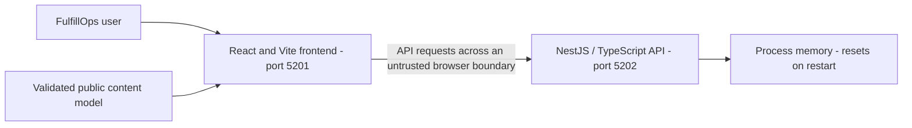
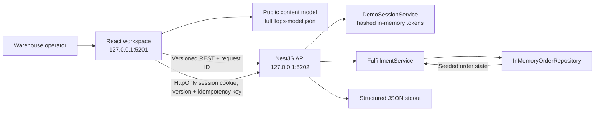
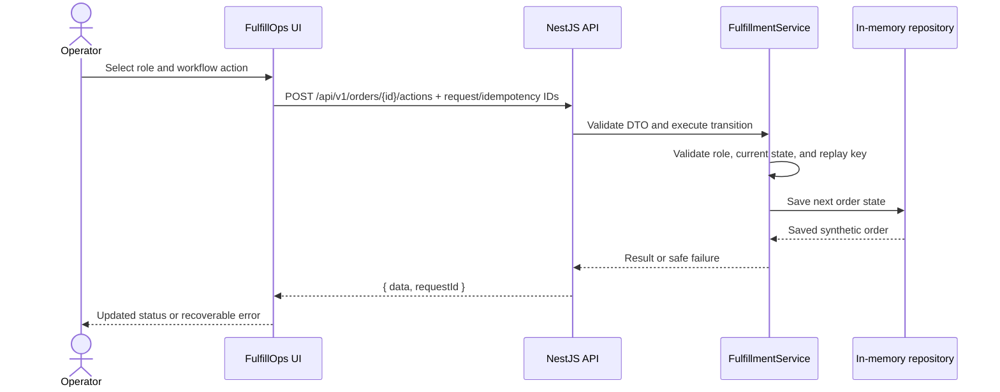
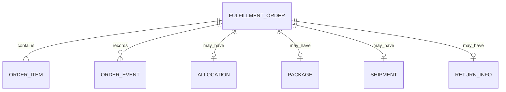
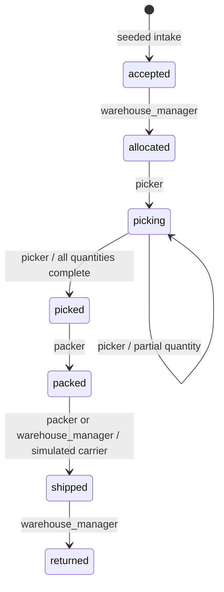
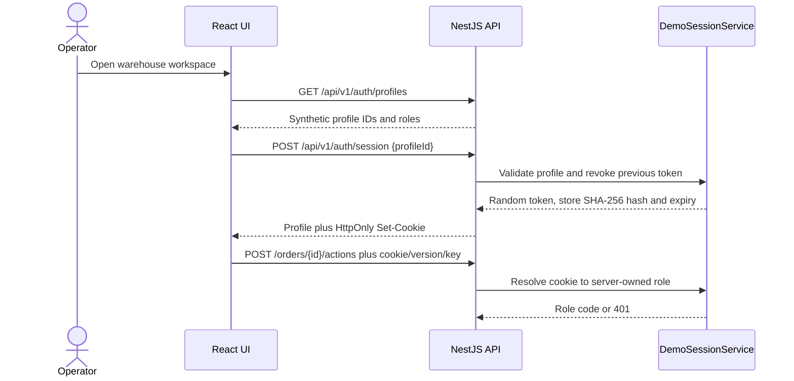

# FulfillOps Backend Architecture

Maintained in this independent Git repository at **docs/architecture.md**. Updated **2026-11-09**. The guide covers the implemented stack, interfaces, data model, operational limits, and release requirements.

## Contents

1. [Scope, users, and repository boundary](#1-scope-users-and-repository-boundary)
2. [Context, containers, and trust boundaries](#2-context-containers-and-trust-boundaries)
3. [Source ownership and module map](#3-source-ownership-and-module-map)
4. [Screens, navigation, and lifecycle](#4-screens-navigation-and-lifecycle)
5. [Primary workflows and recovery](#5-primary-workflows-and-recovery)
6. [Domain, persistence, and data ownership](#6-domain-persistence-and-data-ownership)
7. [API and internal contracts](#7-api-and-internal-contracts)
8. [Security, privacy, and egress](#8-security-privacy-and-egress)
9. [Design, accessibility, and platform adapters](#9-design-accessibility-and-platform-adapters)
10. [Build, checks, and deployment](#10-build-checks-and-deployment)
11. [Architecture decisions and tradeoffs](#11-architecture-decisions-and-tradeoffs)
12. [Requirements traceability](#12-requirements-traceability)
13. [Dated verification and limitations](#13-dated-verification-and-limitations)
14. [Extension rules and companion repository](#14-extension-rules-and-companion-repository)

## 1. Scope, users, and repository boundary

Warehouse workflow simulation for pickers, packers, and warehouse managers.

Order queues, picking, packing, simulated shipping, returns, and workflow recovery.

This repository owns the NestJS / TypeScript API and Process memory state. UI rendering belongs to the separate frontend. The service validates and executes the domain operations described below.

There are two independent Git roots for this application, each with its own README and architecture guide. A parent app/workspace folder is a checkout convenience. Use synthetic records; current local services remain on loopback.

### Scope and users

FulfillOps is a local warehouse-workflow simulator for seeded synthetic orders. The frontend is a React + TypeScript console on loopback port 5201; the NestJS API listens on loopback port 5202. There is no database or live carrier integration.

the relevant configuration or validation section in this guide
for current verification results and deployment blockers.

## 2. Context, containers, and trust boundaries

The API is the data authority, but only the identity/ownership controls actually implemented below can be relied on. CORS is not authentication.

### Context and containers

The browser is untrusted. The API validates request DTOs, derives the active role from an opaque server-issued session cookie, and validates order state transitions and idempotency keys. The UI's profile selector creates a local synthetic session; it is not proof of a real person or production authentication. Mutating requests do not send a client-supplied role header. The API stores only a hash of the random session token in its in-memory session map. Sessions expire after eight hours and are revoked when the profile changes or the user signs out.

There is no user-owned or tenant-owned order data: all synthetic orders belong to the single local warehouse workspace and are visible to every available synthetic profile. Profiles may read order queues; only roles authorized for a particular action may change order state. There is no durable data store or external service boundary. The service must not be exposed outside loopback.

## 3. Source ownership and module map

| Owner/path                                                                                                                                                                                                                                  | Responsibility                                                               |
| ------------------------------------------------------------------------------------------------------------------------------------------------------------------------------------------------------------------------------------------- | ---------------------------------------------------------------------------- |
| [src/main.ts](../src/main.ts)                                                                                                                                                                                                               | Process bootstrap, HTTP composition, and configuration                       |
| [src/app.controller.ts](../src/app.controller.ts) [src/auth/demo-auth.controller.ts](../src/auth/demo-auth.controller.ts) [src/fulfillment/fulfillment.controller.ts](../src/fulfillment/fulfillment.controller.ts)                   | HTTP route and request-adapter owners                                        |
| [src/auth/demo-session.service.ts](../src/auth/demo-session.service.ts) [src/fulfillment/fulfillment.service.ts](../src/fulfillment/fulfillment.service.ts)                                                                              | Application workflow/state-machine owners                                    |
| [src/fulfillment/data/order.repository.ts](../src/fulfillment/data/order.repository.ts)                                                                                                                                                     | Storage/transaction owners; memory where implemented                         |
| [src/auth/demo-auth.controller.ts](../src/auth/demo-auth.controller.ts) [src/auth/demo-session.service.ts](../src/auth/demo-session.service.ts) [src/auth/dto/create-demo-session.dto.ts](../src/auth/dto/create-demo-session.dto.ts) | Existing session/role/limiter modules; their presence is not a hosting claim |
| [src/common/api-exception.filter.ts](../src/common/api-exception.filter.ts) [src/common/request-context.middleware.ts](../src/common/request-context.middleware.ts)                                                                      | Safe errors, origin handling, or request correlation as implemented          |
| [openapi.json](../openapi.json)                                                                                                                                                                                                             | Published request/response contract source                                   |
| [test](../test)                                                                                                                                                                                                                             | Existing test/support directory; configured does not mean rerun              |
| [.github/workflows](../.github/workflows)                                                                                                                                                                                                   | Configured CI; hosted outcomes require separate verification                 |
| [src/app.controller.spec.ts](../src/app.controller.spec.ts) [src/auth/demo-session.service.spec.ts](../src/auth/demo-session.service.spec.ts)                                                                                            | Examples of existing colocated tests                                         |

The source map follows the existing framework directories and test placement.

## 4. Screens, navigation, and lifecycle

This repository has no rendered screens. It supports the frontend through the HTTP/domain contracts in sections 5–7. Its lifecycle entry, response/error mapping, session behavior where present, and storage ownership are listed in section 3. Startup health is http://127.0.0.1:5202/api/v1/health; that configured address is not evidence of a running service. All state is discarded on restart.

## 5. Primary workflows and recovery

### Current product use cases

1. **Open workspace and session:** load the validated content model, fetch API
   roles, and create the default synthetic `picker` session. Profile changes
   rotate the prior cookie-backed session. Missing API/profile/session data is
   surfaced with model copy and a retry path.
2. **Review summary and queue:** load open-order, pick-ready, packed, and at-risk
   metrics; list orders with bounded status, search, and limit filters.
3. **Inspect an order:** fetch an order detail, inspect items, locations,
   promised time, current status, version, and event history.
4. **Allocate:** a warehouse manager allocates only an `accepted` order; the API
   records an allocation reference and increments the order version.
5. **Pick:** a picker records item quantities for allocated/picking orders;
   unknown SKUs, missing quantities, and over-picking fail without changing the
   order. Partial picks remain `picking`; completing every line advances to
   `picked`.
6. **Pack:** a packer may pack only a fully picked order. The API creates a
   synthetic package ID and records the timestamp.
7. **Ship:** a packer or warehouse manager may ship only a packed order. The API
   creates a `ParcelPilot`-shaped simulation and `SIM-*` tracking number; no
   carrier request is made.
8. **Return:** a warehouse manager may return only a shipped order and must
   provide a supported reason.
9. **Recover:** API/network failures preserve existing page state where
   possible and show safe model messages; refresh/retry reloads server data.
   Stale versions, denied roles, invalid transitions, and duplicate-key
   conflicts are surfaced without presenting a failed action as complete.
10. **Switch data source:** each build selects mock or live API endpoints
    explicitly. Both test modes use a dedicated ephemeral API; they do not
    bypass the backend with browser-generated order state.

Order intake, wave planning, label printing, cancellation, durable persistence,
warehouse/tenant isolation, real identity, live carrier integration, and
PortfolioOps export are not implemented. The current seed repository creates
the initial orders; there is no order-intake API.

### Primary workflow

Precondition: the local UI/API are available, a synthetic profile session is
active, and the seeded order is in a state compatible with the selected action.
A manager allocates; a picker records item picks; a packer packs and simulates
shipment; a manager records a return. Each command validates the session role,
order version/state, payload, and idempotency key before saving a cloned order.
Success updates the UI and records a safe workflow event. Invalid/expired
sessions, roles, transitions, or payloads return a safe error and can be retried
after selecting a valid profile or refreshing; the order remains unchanged on
failure.

## 6. Domain, persistence, and data ownership

The API owns the current persistence boundary. Keep database engines, schema/migration order, exact-money rules where applicable, and transaction invariants consistent with executable source.

### Domain and data ownership

The backend owns the in-memory order map. A `FulfillmentOrder` contains status,
priority, channel, zone, promised time, items, allocation, package, shipment,
return information, version, and workflow events. `OrderItem` records ordered
and picked quantities. Synthetic profiles contain only a stable role ID and role
code; no password or customer record exists. Session tokens are random and
stored as SHA-256 hashes with expirations. Order state, session state, and
idempotency results reset when the API process restarts; there is no database.

## 7. API and internal contracts

The repository contract is [openapi.json](../openapi.json). Keep public paths, status/error envelopes, headers, payload validation, and compatibility tied to that source.

### API-backed mock/live selection

The frontend reads the build-time `VITE_IS_MOCK` flag. The default is `true`.
Mock mode selects `VITE_MOCK_API_BASE_URL`; live-selection mode selects
`VITE_REAL_API_BASE_URL`. Production builds require the selected endpoint to be
explicitly configured; mode selection never falls back to the other endpoint.
The mock and live-selection E2E runs point at separate, isolated test API
instances while making the unselected endpoint unavailable. This proves URL
selection and API-backed workflow routing, not real identity, durable storage,
or a carrier integration. `VITE_API_BASE_URL` is a development-only mock alias.

### API and authorization

Routes are versioned under `/api/v1` and specified by
[`fulfillops-backend/openapi.json`](../openapi.json).
Responses use `{ data, requestId }`; failures use the centralized safe error
envelope. The architecture and API design stay in documentation; the frontend
does not render architecture diagrams or API schemas as product UI.

| Route                                                            | Authorization / behavior                                                                                             |
| ---------------------------------------------------------------- | -------------------------------------------------------------------------------------------------------------------- |
| `GET /health`                                                    | Health and readiness for the local process.                                                                          |
| `GET /auth/profiles`                                             | Development/test only; returns synthetic profile IDs and role codes, never credentials.                              |
| `POST /auth/session`                                             | Development/test only; validates profile ID, rotates an existing session, and sets an HttpOnly cookie.               |
| `POST /auth/logout`                                              | Revokes the current in-memory session and expires the cookie.                                                        |
| `GET /summary`, `GET /orders`, `GET /orders/:id`, `GET /returns` | Read-only synthetic workspace data; order lists are bounded to 50.                                                   |
| `POST /orders/:id/actions`                                       | Requires a valid session cookie, action-specific role, idempotency key, current order version, and DTO-valid action. |

Role policy is enforced on the server: `warehouse_manager` allocates and records
returns; `picker` picks; `packer` packs and ships; managers may ship. Unknown
profile IDs are rejected; no client-supplied role header grants privileges.
Invalid transitions and unauthorized actions are rejected without changing the
order. A replay with the same idempotency key and fingerprint returns the
previous result; reusing a key for another action is a conflict.

#### State transitions and role matrix

The API rejects all other transitions. Picks must reference an order SKU and
cannot exceed remaining quantity. Every mutation checks the client-observed
`version` against the server order version and advances it once on success.

#### Synthetic profile/session sequence

## 8. Security, privacy, and egress

Current release limitation: **All server state resets on API restart. The archived production entry and browser command are incorrect for this Windows setup; use dist/src/main.js and the workspace E2E adapter. Real warehouse authorization and durable state remain absent.**

Only the local simulator controls in the current source are implemented. CORS, a role label, and mode selection do not provide a new production identity boundary.

Keep private credentials out of public models, browser bundles, logs, URLs, and source archives. No additional runtime network destination or external service is configured. Keep logs limited to the source-defined request/trace and safe aggregate fields. Backups, retention, deletion, and real-user ownership need explicit product/operations decisions before external exposure.

## 9. Design, accessibility, and platform adapters

There is no visual rendering or native package in this API repository. Preserve safe errors and stable contracts so the frontend can present accessible recovery states. Hardware scanning, banking/payment rails, shipping providers, and native integrations remain limited to what the current source actually implements; simulator behavior is not device/provider integration.

## 10. Build, checks, and deployment

Configured npm scripts, from this repository with Node **24.15.0**; use `npm.cmd` in PowerShell:

| Command                        | Actual manifest definition                                                                                   |
| ------------------------------ | ------------------------------------------------------------------------------------------------------------ |
| `npm.cmd run build`            | `nest build`                                                                                                 |
| `npm.cmd run format:check`     | `prettier --check "src/**/*.ts" "test/**/*.ts" "scripts/validate-openapi.mjs" "openapi.json" "package.json"` |
| `npm.cmd run start`            | `nest start`                                                                                                 |
| `npm.cmd run start:dev`        | `nest start --watch`                                                                                         |
| `npm.cmd run start:prod`       | `node dist/main`                                                                                             |
| `npm.cmd run lint`             | `eslint "{src,apps,libs,test}/**/*.ts"`                                                                      |
| `npm.cmd run validate:openapi` | `node scripts/validate-openapi.mjs`                                                                          |
| `npm.cmd run test`             | `jest`                                                                                                       |
| `npm.cmd run test:cov`         | `jest --coverage`                                                                                            |
| `npm.cmd run coverage:check`   | `node scripts/check-coverage.mjs`                                                                            |
| `npm.cmd run test:e2e`         | `jest --config ./test/jest-e2e.json`                                                                         |

Install with `npm.cmd ci` and retain [package-lock.json](../package-lock.json). Registry access is required for a clean dependency installation. These commands describe the configured checks; execution results are listed in section 13.

The API remains loopback-only. Storage is process memory and resets on restart. The emitted API entry is dist/src/main.js; the archived start:prod path is incorrect. No database is required.

CI configuration is listed in section 3. Run the configured checks before merging or releasing. Deployment requires separate verification of the selected hosting environment.

## 11. Architecture decisions and tradeoffs

### Design patterns and decisions

- **Modular monolith:** `FulfillmentModule` contains the order API, service,
  repository interface, in-memory repository, DTOs, and session boundary. There
  are no microservices or cross-app database writes.
- **Repository pattern:** `OrderRepository` abstracts reads and writes;
  `InMemoryOrderRepository` seeds synthetic orders and returns clones so failed
  commands cannot mutate saved state.
- **State machine:** `FulfillmentService` owns legal transitions; React state
  never advances an order by itself.
- **Optimistic concurrency:** each order has a `version`. The API compares the
  submitted version before applying an action and returns `409 STALE_ORDER`
  when the order has changed.
- **Idempotency:** a bounded process-local map fingerprints order, role, action,
  and version. Exact retries return the stored result; key reuse for a different
  action conflicts. The map is not durable and resets on restart.
- **Synthetic session:** the API validates a known profile ID, issues a random
  token in an HttpOnly/SameSite cookie, stores only its hash, and expires it
  after eight hours. Profile switching revokes the prior cookie token. This
  simulates role-bound sessions; it does not verify a real person's identity.
- **Stack decision:** the APP-06 blueprint recommends PostgreSQL persistence,
  but the inspected application is intentionally in-memory. Persistence,
  migrations, outbox, and carrier adapters remain future work; do not infer
  those features from the blueprint.

The two Git repositories remain separate. Each owns one maintained README and this repository-local architecture guide. Shared application behavior may be described here for contract context, but implementation changes belong to the owning source module.

## 12. Requirements traceability

| Capability                       | Acceptance                                                        | Owner/path                         | Current status                                                | Evidence                               | Risk                                                                                                                                                                                                                                              |
| -------------------------------- | ----------------------------------------------------------------- | ---------------------------------- | ------------------------------------------------------------- | -------------------------------------- | ------------------------------------------------------------------------------------------------------------------------------------------------------------------------------------------------------------------------------------------------- |
| Repository-local architecture    | Guide available in this checkout and linked from README           | docs/architecture.md; README.md    | Documented and validated                                      | File, link, and diagram checks         | Keep documentation consistent with source changes                                                                                                                                                                                                 |
| API composition and domain state | Preserve existing workflows and failure states                    | src/main.ts and source map         | Implemented; application verification limits are listed below | Current source and existing app design | All server state resets on API restart. The archived production entry and browser command are incorrect for this Windows setup; use dist/src/main.js and the workspace E2E adapter. Real warehouse authorization and durable state remain absent. |
| Public deployment                | Verified identity, data durability, recovery, and hosted behavior | Existing deployment/API boundaries | Needs separate hardening/verification                         | No new hosted evidence                 | Local checks do not establish production readiness                                                                                                                                                                                                |

## 13. Dated verification and limitations

Last documentation review: **2026-11-09**. The checks below distinguish documentation validation from application and deployment testing.

- Repository-local guide, README link, source-path references, section/contents anchors, and Mermaid syntax: passed documentation validation.
- New application tests/builds, coverage, dependency audits, browser/device accessibility/performance, hosted CI, and Vercel deployment: **not rerun for the documentation updates**.
- Frontend production builds passed on 2026-11-09 with Node 24.15.0. Build success does not establish that all application quality gates pass.
- Outstanding baseline limit: All server state resets on API restart. The archived production entry and browser command are incorrect for this Windows setup; use dist/src/main.js and the workspace E2E adapter. Real warehouse authorization and durable state remain absent.

The baseline results below record earlier validation. Re-run the listed commands against the current revision before release.

Previously recorded application verification:

No additional per-app verification block existed in the source guide; refer to the original validation ledger.

## 14. Extension rules and companion repository

Start with [README.md](../README.md) and this guide. The companion repository is [fulfillops-frontend](https://github.com/gopichand-retail-apps/fulfillops-frontend); clone the pair as siblings when using the existing local integration/model contract. This guide is inside the current repository and does not depend on a parent-folder architecture file to exist.

Update this guide when owned source, routes, persistence, identity, UI states, egress, or deployment behavior changes. Coordinate public contract changes with the companion repository and tests. Preserve existing data, run isolated checks with synthetic records, record failures, and review release and infrastructure changes before publication.
